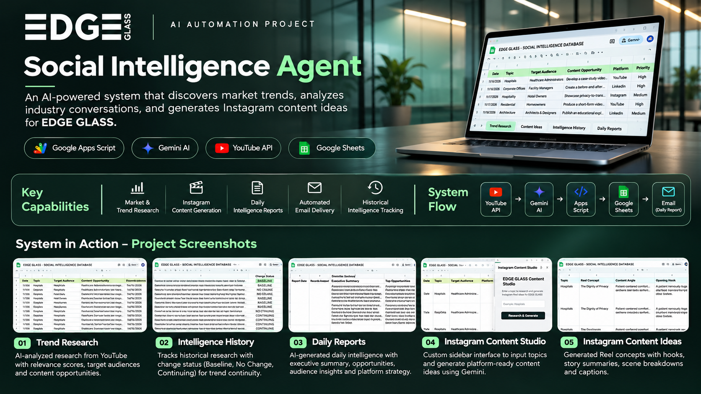
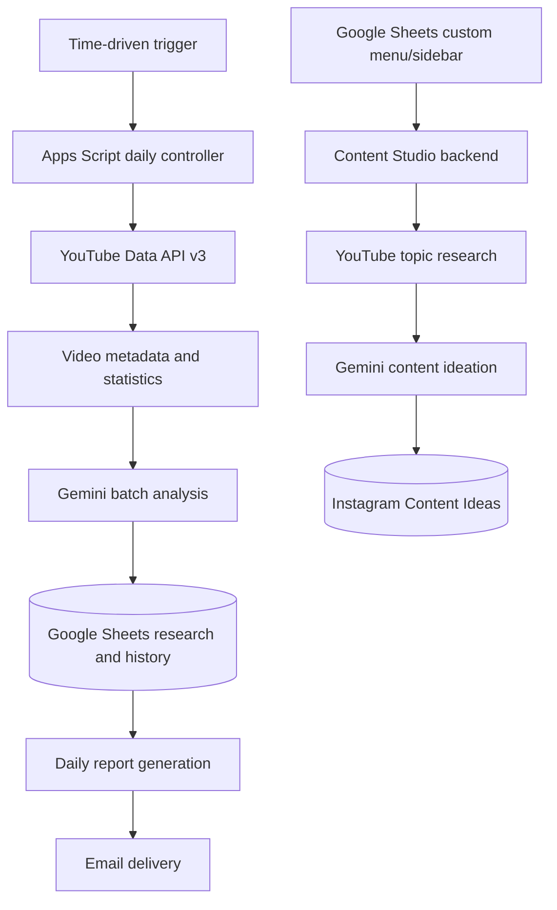
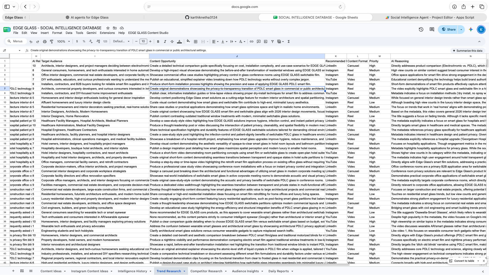
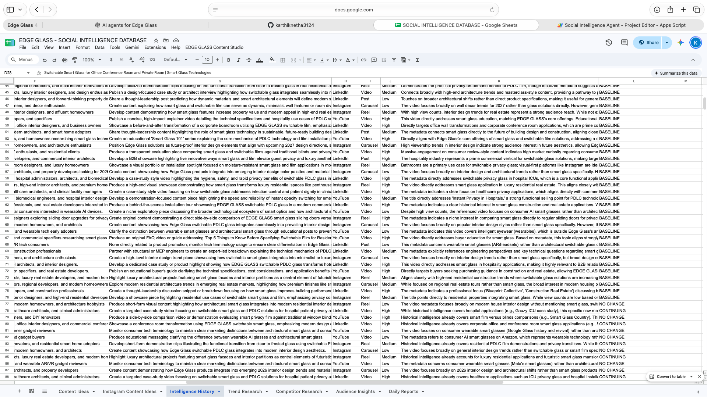
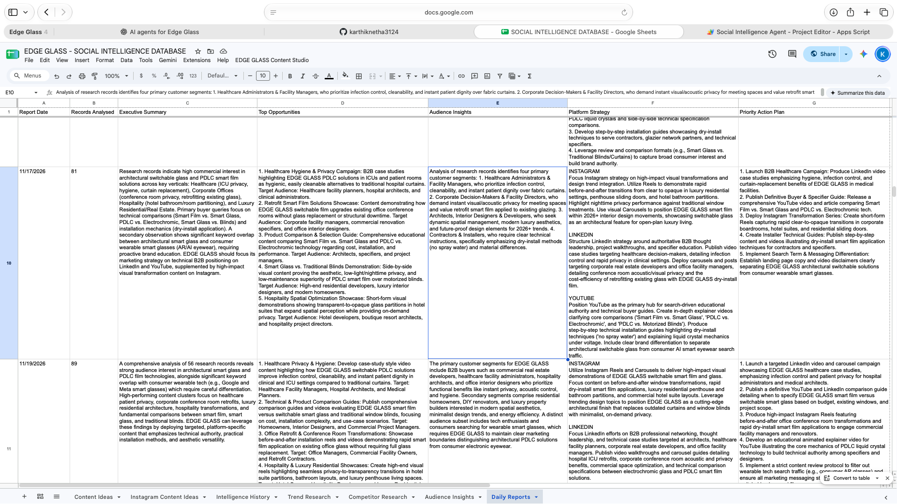
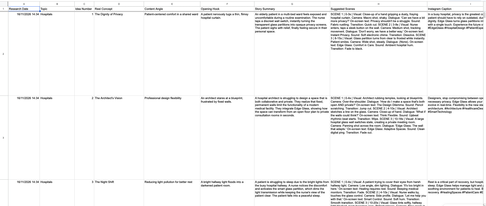
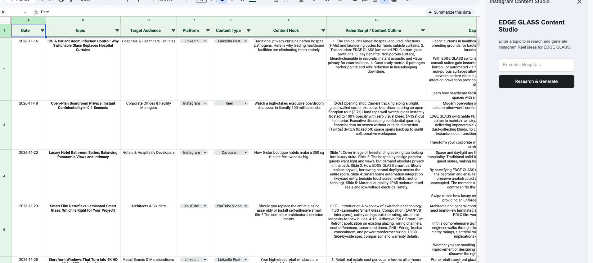

<div align="center">

# EDGE GLASS — Social Intelligence Agent

**AI-assisted social media research, trend analysis and content ideation**

[](https://developers.google.com/apps-script)
[](https://sheets.google.com)
[](https://developers.google.com/youtube/v3)
[](https://ai.google.dev/)
[](#current-scope)

*An AI-assisted system that turns public YouTube signals into structured market intelligence and practical content ideas for EDGE GLASS.*

</div>

---

## Project overview

The EDGE GLASS Social Intelligence Agent is built with **JavaScript on Google Apps Script (V8 runtime)**, Google Sheets, the YouTube Data API v3 and Google Gemini.

It supports two distinct workflows:

1. **Daily intelligence pipeline** — searches configured YouTube topics, collects public video data, asks Gemini to analyse records, stores research history, generates a daily report and emails it.
2. **Instagram Content Studio** — accepts a user-entered topic through a Google Sheets sidebar, uses YouTube results as research context, and generates structured Instagram Reel concepts.

The system runs on Google's managed Apps Script infrastructure. Google Sheets is the data store and working interface; a separately managed server is not required.

## Verified workbook snapshot

The following counts were checked against the exported workbook supplied during project documentation. They describe that snapshot, not live totals.

| Workbook tab | Populated records | What it contains |
|---|---:|---|
| Trend Research | 92 | YouTube research records and AI analysis |
| Intelligence History | 92 | Historical analysis and change-status labels |
| Daily Reports | 11 | Generated daily intelligence reports |
| Content Ideas | 10 | Broader social content plans |
| Instagram Content Ideas | 15 | Reel concepts and creative direction |
| Competitor Research | 0 | Empty in the reviewed snapshot |
| Audience Insights | 0 | Empty in the reviewed snapshot |

See the [workbook data dictionary](docs/DATA_DICTIONARY.md) for observed columns and interpretation notes.

## Key capabilities

- Topic-based discovery using YouTube Data API v3.
- Public video metadata and available engagement-stat collection.
- URL-based duplicate avoidance.
- Batch analysis with Gemini.
- Structured recommendations for audience, content opportunity, platform, format and priority.
- Historical status tracking, including BASELINE, NO CHANGE and CONTINUING.
- Daily report generation and email delivery.
- On-demand Instagram Reel concept generation through a custom Sheets sidebar.

## How the system works

### Daily intelligence workflow

1. A time-driven Apps Script trigger starts the daily controller.
2. Apps Script searches YouTube for configured smart-glass and architecture themes.
3. Public video metadata and available statistics are collected; previously stored URLs are used to avoid duplicate processing.
4. Gemini analyses records in batches and returns structured findings.
5. Research and historical analysis are stored in Google Sheets.
6. A daily report is assembled and emailed to configured recipients.

### Instagram Content Studio workflow

1. A user opens the custom sidebar from Google Sheets.
2. The user enters a topic and starts research.
3. The Apps Script backend searches YouTube and collects supporting metadata.
4. Gemini generates structured Reel concepts.
5. The concepts are saved to the Instagram Content Ideas tab.

A concept can include a content angle, opening hook, story summary, scene-by-scene direction, caption, hashtags, call to action and cover text.

## Architecture



For component responsibilities and data flow, read [Architecture](docs/ARCHITECTURE.md).

## System in action

These are screenshots from the working spreadsheet and content studio.

### 1. Trend Research

Collected YouTube sources with AI relevance scores, target audiences, content opportunities, platform recommendations, priorities and reasoning.



### 2. Intelligence History

Historical research records with change-status labels, including BASELINE, NO CHANGE and CONTINUING.



### 3. Daily Intelligence Report

Generated executive summary, top opportunities, audience insights, platform strategy and priority action plan.



### 4. Instagram Content Studio

The custom Google Sheets sidebar used to submit a topic and request Instagram Reel concepts.



### 5. Instagram Content Ideas

Generated Reel concepts with hooks, story summaries, suggested scenes and captions.



## Technology stack

| Layer | Technology | Responsibility |
|---|---|---|
| Backend | JavaScript, Apps Script V8 | Orchestration, API calls and spreadsheet operations |
| User interface | HTML, CSS, client-side JavaScript | Custom sidebar |
| UI/backend bridge | `google.script.run` | Calls Apps Script functions from the sidebar |
| Research source | YouTube Data API v3 | Topic search and public video data |
| AI | Google Gemini API | Research analysis and content ideation |
| Storage | Google Sheets | Research, history, reports and content ideas |
| Scheduling | Apps Script time-driven triggers | Automated daily execution |
| Email | Apps Script Mail service | Daily report delivery |

## Repository structure

```text
.
├── src/
│   ├── EGSocial.gs
│   └── ContentStudio.html
├── docs/
│   ├── SETUP.md
│   ├── ARCHITECTURE.md
│   ├── DATA_DICTIONARY.md
│   └── INTERVIEW_GUIDE.md
├── screenshots/
│   ├── 01-trend-research.png
│   ├── 02-intelligence-history.png
│   ├── 03-daily-report.png
│   ├── 04-content-studio.png
│   └── 05-instagram-ideas.png
└── README.md
```

## Setup and configuration

Start with [Setup and configuration](docs/SETUP.md).

Configure environment-specific values in **Apps Script Project Settings → Script Properties**. The implementation expects:

- `YOUTUBE_API_KEY`
- `GEMINI_API_KEY`
- `SPREADSHEET_URL`

Never commit API keys, spreadsheet URLs or IDs, private email addresses, customer records or confidential company information.

## Current scope and limitations

- YouTube is the discovery source. Instagram is the intended destination for content ideas; the system does **not** directly monitor Instagram Reels.
- The Content Studio generates text-based concepts and production direction. It does **not** render finished videos, publish posts or schedule Instagram uploads.
- The dedicated Competitor Research and Audience Insights tabs were empty in the reviewed workbook snapshot. They are not represented as completed automated modules.
- AI-generated claims and recommendations need human review before business use.
- API quotas, service availability, permissions and model responses are operational dependencies.
- Workbook counts are a dated evidence snapshot and will change as the system runs.

## AI-assisted development and project ownership

AI tools assisted with code generation and development. The project is presented transparently as an **AI-assisted build**. The project owner's focus is understanding and explaining the architecture, integrations, data flow, configuration, operational behaviour, testing and limitations rather than claiming every line was independently authored.

## Documentation

- [Setup guide](docs/SETUP.md)
- [Architecture and data flow](docs/ARCHITECTURE.md)
- [Workbook data dictionary](docs/DATA_DICTIONARY.md)
- [Interview preparation guide](docs/INTERVIEW_GUIDE.md)

---

<div align="center">

**EDGE GLASS · Social Intelligence Agent**

*Research signals → structured insights → actionable content ideas*

</div>
