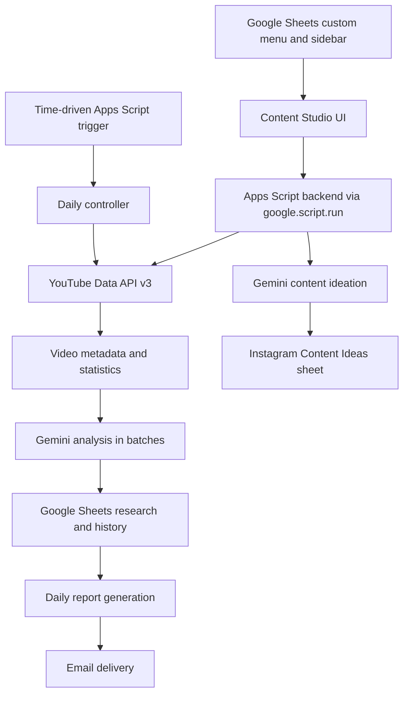

# EDGE GLASS Social Intelligence Agent

An AI-assisted research and content-planning system built with **Google Apps Script (JavaScript, V8 runtime)**, Google Sheets, the YouTube Data API v3 and Google Gemini.

It supports two workflows: a scheduled YouTube-based social intelligence pipeline and an on-demand Instagram Reel ideation studio. The workbook snapshot documented here contains real outputs from the working system.

## At a glance

- **Research records:** 92 populated rows in `Trend Research`.
- **Historical analysis:** 92 populated rows in `Intelligence History`.
- **Daily reports:** 11 populated reports in `Daily Reports`.
- **Content planning:** 10 populated rows in `Content Ideas`.
- **Instagram ideation:** 15 populated Reel concepts in `Instagram Content Ideas`.
- **Not yet populated:** `Competitor Research` and `Audience Insights` are present as empty tabs in the supplied workbook snapshot.

These counts describe the exported workbook snapshot, not live or continuously updated totals. See [the data dictionary](docs/DATA_DICTIONARY.md) for the sheet-level detail.

## Workflows

### 1. Daily social media intelligence

1. A time-driven Apps Script trigger starts the daily controller.
2. The script searches YouTube for configured smart-glass and architecture topics.
3. It collects public video metadata and available engagement statistics, while avoiding URLs already recorded.
4. Gemini analyses records in batches and returns structured findings, including audience, content opportunity, recommended platform/format, priority and reasoning.
5. Research and historical status are written to Google Sheets.
6. A daily report is generated and emailed to configured recipients.

The tracked research themes include PDLC/smart-glass technology, architecture and interiors, healthcare privacy, hospitality, corporate offices, construction/real estate, FAQs, and comparisons with conventional privacy solutions.

### 2. Instagram Content Studio

The user opens a custom sidebar in Google Sheets, enters a topic, and requests content concepts. The backend uses YouTube search results as supporting research, then asks Gemini to create structured Reel ideas and saves them to `Instagram Content Ideas`.

The saved concepts can include an angle, opening hook, story summary, scene-by-scene direction, caption, hashtags, CTA, cover text and research references.

**Scope boundary:** this is Instagram-focused ideation informed by YouTube research. It does not directly monitor Instagram Reels, publish or schedule Instagram posts, or render finished videos.

## Architecture

Google Apps Script runs on Google's managed infrastructure. Google Sheets is the working data store and interface; a separately managed server is not required.

See [the architecture notes](docs/ARCHITECTURE.md) for the component responsibilities and data flow.

## Technology

| Layer | Technology | Role |
|---|---|---|
| Backend and automation | JavaScript on Google Apps Script V8 | Scheduled jobs, API calls, processing and spreadsheet operations |
| Sidebar interface | HTML, CSS and client-side JavaScript | Topic input and content-studio interaction |
| UI-to-backend bridge | `google.script.run` | Calls server-side Apps Script functions from the sidebar |
| Research source | YouTube Data API v3 | Topic-based video search and public metadata |
| AI | Google Gemini API | Research analysis and structured content ideation |
| Storage and interface | Google Sheets | Research records, history, reports and ideas |
| Scheduling and email | Apps Script triggers and Mail service | Daily execution and report delivery |

## Repository layout

- `src/EGSocial.gs` — Apps Script backend.
- `src/ContentStudio.html` — sidebar interface.
- `docs/SETUP.md` — deployment and configuration notes.
- `docs/ARCHITECTURE.md` — architecture and workflow explanation.
- `docs/DATA_DICTIONARY.md` — workbook tabs, fields and snapshot counts.

## Configuration and security

Configure secrets through **Apps Script Project Settings → Script Properties**, not in source code. The implementation expects:

- `YOUTUBE_API_KEY`
- `GEMINI_API_KEY`
- `SPREADSHEET_URL`

Do not commit API keys, spreadsheet URLs/IDs, private email addresses, customer records or other confidential business information. The repository source is intended to use Script Properties for environment-specific configuration.

## Limitations and current scope

- YouTube is the research source; Instagram is the target platform for content ideas, not a directly monitored source.
- AI-generated insights and marketing claims require human review before publication. Validate numerical or technical claims against reliable product and project evidence.
- API availability, quota limits and model responses can affect results.
- The workbook contains empty `Competitor Research` and `Audience Insights` tabs. Their presence does not mean those modules are implemented or populated.
- The counts above are from one exported workbook snapshot and will change as the system runs.

## AI-assisted development

AI tools assisted with code generation and development. The project owner is transparent about that assistance and focuses on understanding the architecture, integrations, data flow, configuration, operational behaviour, testing and limitations. The project is presented as an AI-assisted build, not as a claim that every line was independently authored.

## Evidence and documentation

The workbook snapshot is the evidence for the record counts and populated tabs described above. It is not a substitute for a live production audit. For setup and operation, start with [Setup](docs/SETUP.md), then read the [Architecture](docs/ARCHITECTURE.md) and [Data Dictionary](docs/DATA_DICTIONARY.md).
