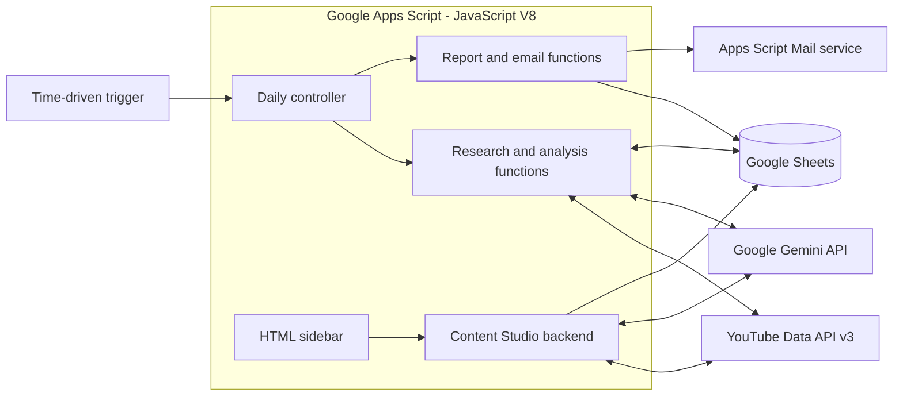

# Architecture and data flow

## Runtime

The backend is written in JavaScript and runs in the Google Apps Script V8 runtime on Google's managed infrastructure. It is not a continuously running process on a personal computer or a separately hosted Node.js server.

Google Sheets provides the operational interface and persistent tabular storage. Apps Script reads and writes spreadsheet ranges and uses Script Properties for environment-specific configuration.

## Daily intelligence workflow

1. **Trigger and orchestration** — a time-driven Apps Script trigger invokes the daily controller. A script lock helps prevent overlapping executions.
2. **Discovery** — the backend calls YouTube Data API v3 using the configured topic searches.
3. **Collection and deduplication** — public video details and available statistics are collected. Previously recorded video URLs are used to avoid duplicate processing.
4. **AI analysis** — records are sent to Gemini in batches. The analysis is expected to return structured fields such as relevance, target audience, opportunity, recommended platform, format, priority and reasoning.
5. **Persistence** — the research results and historical analysis are written to the relevant Google Sheets tabs.
6. **Reporting** — a daily report is assembled from the analysed records and emailed using the Apps Script Mail service.

## On-demand Content Studio workflow

1. A user opens the custom menu/sidebar in the spreadsheet.
2. The sidebar accepts a topic and calls the Apps Script backend using `google.script.run`.
3. The backend searches YouTube for topic-related source material and gathers available metadata.
4. Gemini is prompted to produce structured Instagram Reel concepts.
5. The concepts and their research references are saved to `Instagram Content Ideas`.

## System boundaries

- YouTube Data API v3 supplies the discovery data. The system does not directly query Instagram's Reels feed.
- Gemini produces analysis and creative suggestions; it does not verify every factual claim.
- The Content Studio produces text-based concepts and production direction. It does not render video, publish posts or schedule Instagram uploads.
- Google Apps Script quotas, API quotas, permissions and model availability are operational dependencies.

## Conceptual component diagram

## How to explain it in an interview

> "I built an AI-assisted automation in Google Apps Script. A scheduled trigger starts a YouTube research pipeline, the backend collects public video metadata, sends batches to Gemini for structured analysis, stores the results in Google Sheets, and emails a daily report. Separately, a spreadsheet sidebar lets a user request Instagram Reel concepts; that workflow uses YouTube research as context and saves Gemini-generated ideas back to the workbook. The backend is JavaScript running in Google's Apps Script V8 environment."
